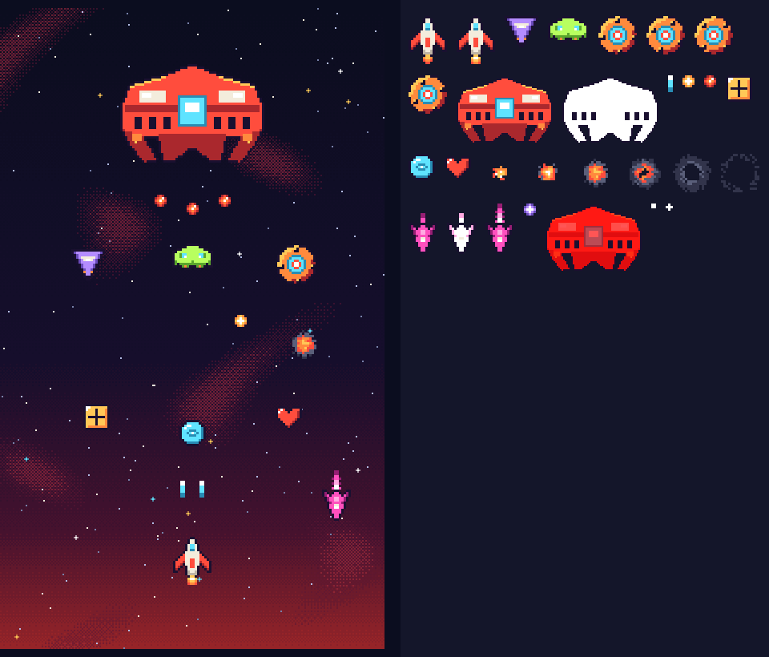

# Langit Merah

*Langit Merah* ("Red Sky") is a small retro arcade shooter that runs in the browser. Fly your ship across a red night sky, dodge enemy fire, grab power-ups and take down the boss. It works on desktop and on phones. The in-game text is in Indonesian.



## How to play

| Action      | Keyboard              | Phone                          |
|-------------|-----------------------|--------------------------------|
| Move        | ← → or A / D          | Drag your finger               |
| Shoot       | Hold Space            | Automatic                      |
| Pause       | P                     | Pause button on screen         |

Destroy enemies to build your combo, collect power-ups (gun upgrade, shield, extra life) and survive the waves until the boss shows up. Your best score is saved in your browser.

## Run it locally

No build step. Open `index.html` in a browser, or serve the folder:

```bash
python3 -m http.server 8000
# then open http://localhost:8000
```

## Deploy

It is a static site, so any static host works. On [Vercel](https://vercel.com): **Add New → Project**, import this repository, keep the framework preset as **Other**, leave the build command empty, and deploy. GitHub Pages works too (Settings → Pages → branch `main`, root folder).

## Files

| Path                     | What it is                                                       |
|--------------------------|------------------------------------------------------------------|
| `index.html`             | The whole game (Phaser 3.60). The `BALANCE` block near the top holds the tuning numbers. |
| `sprites-embed.js`       | Pixel art packed as data URIs, so the game needs no extra image requests. |
| `audio-embed.js`         | Music and sound effects packed as data URIs.                     |
| `assets/art/`            | Source sprites (PNG), the sprite sheet and the script that generates them (`make_art.py`, needs Pillow). |
| `assets/audio/`          | Music loop and sound effects (MP3 and OGG) and the script that synthesises them (`make_audio.py`, needs NumPy and ffmpeg). |

All art and audio were made for this game from code; no third-party assets are used. The only runtime dependency is [Phaser](https://phaser.io/) 3.60, loaded from cdnjs.

## License

[MIT](LICENSE) © 2026 dinamo (dynamolabs)
